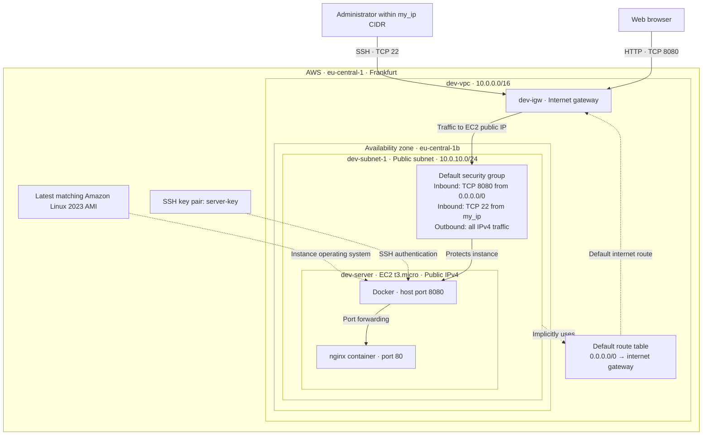

# Terraform project architecture

This diagram represents the infrastructure defined by the Terraform configuration.

- `modules/vpc` creates the VPC.
- `modules/subnet` creates the subnet and internet gateway, and manages the VPC's default route table. The subnet inherits this route table without an explicit association resource.
- `modules/webserver` manages the default security group, registers the SSH public key, looks up the AMI, and creates EC2. Its user-data script installs Docker and runs `docker run -d -p 8080:80 nginx`.
- The root output `ec2_public_ip` supplies the address for `http://<ec2_public_ip>:8080`.

Solid arrows show traffic or instance relationships; dotted arrows show routing and provisioning relationships. The security group applies to EC2's network interface; it is drawn separately to make its rules visible.
